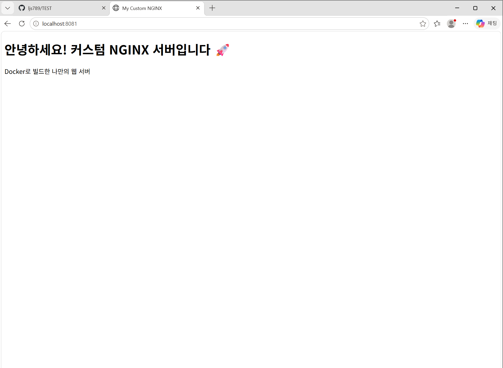
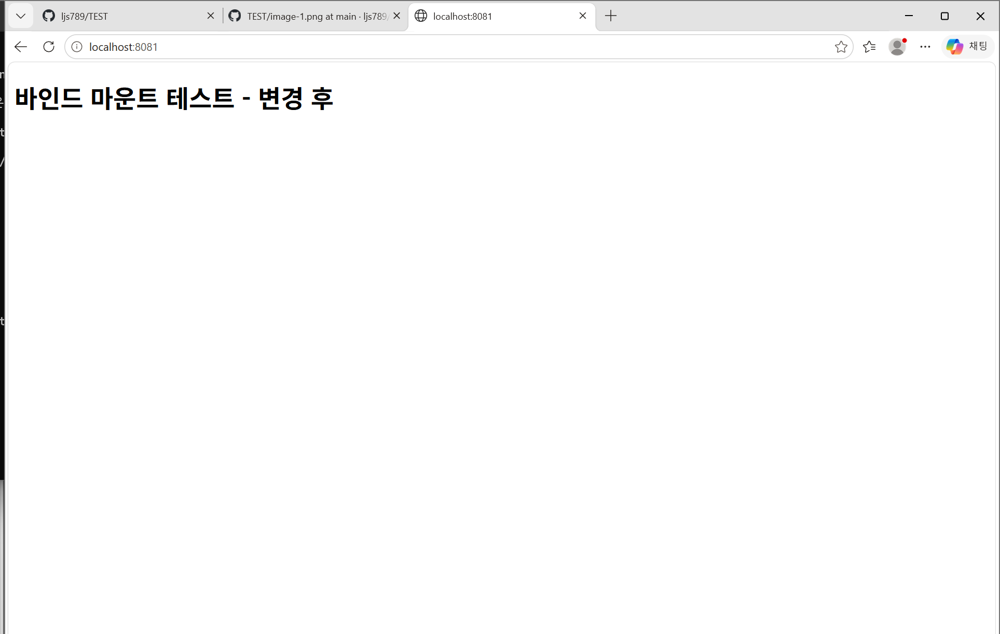
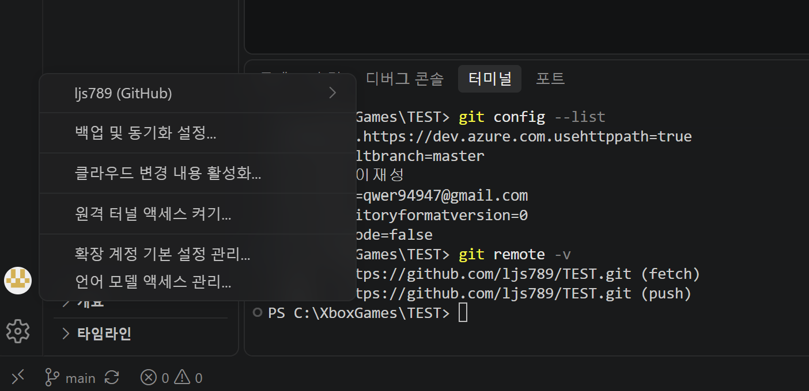

# 워크스테이션 구축 결과물

## 1. 프로젝트 개요

터미널·Docker·Git을 직접 세팅하여 "내 컴퓨터에서만 돌아가는" 문제를 줄이고, 누구나 동일하게 실행·배포·디버깅할 수 있는 재현 가능한 개발 환경을 구축한다. 웹 서버를 컨테이너화하고 포트 매핑·볼륨으로 접속과 데이터 영속성을 직접 검증한다.

## 2. 실행 환경

- OS: Ubuntu 26.04.1 LTS (WSL2)
- Shell: bash
- Docker: 29.9.3
- Git: 2.53.0

## 3. 디렉토리 구조와 설계 기준

```text
TEST/ (작업 폴더: ~/custom-nginx)
├── Dockerfile        # 이미지 설계도 (빌드 설정)
├── html/             # 웹 서버가 보여 줄 소스(정적 파일)
│   └── index.html
├── README.md         # 기술 문서 (수행 로그·증거)
├── image-1.png       # 증거: 브라우저 포트 매핑 접속 화면
├── image-2.png       # 증거: 바인드 마운트·볼륨 실습 화면
└── image-3.png       # 증거: GitHub/VSCode 연동 화면
```

| 폴더/파일 | 역할 | 이렇게 나눈 기준 |
|---|---|---|
| `Dockerfile` | 이미지를 어떻게 만들지 적은 **빌드 설정** | 빌드 기준 위치(컨텍스트)인 최상위에 둠 → `docker build .` 한 줄로 빌드 가능 |
| `html/` | 실제로 서비스되는 **소스** | 소스만 따로 모아 두면 `COPY html/ ...` 한 줄로 복사되고, 바인드 마운트 대상으로도 그대로 쓸 수 있음 |
| `README.md` | **문서** | 저장소 첫 화면에서 바로 보이도록 최상위에 둠 |
| `image-*.png` | **증거 스크린샷** | README 에서 상대 경로로 바로 불러올 수 있게 같은 위치에 둠 |

- 원칙: **소스 / 빌드 설정 / 문서를 서로 섞지 않는다.** 이미지에는 필요한 것(`html/`)만 들어간다.
- 터미널 실습용 폴더 `terminal-practice/` 는 서비스와 관계없는 연습 파일이라 `html/` 과 분리해서 만들었고, 저장소에는 올리지 않았다.

## 4. 수행 항목 체크리스트 및 검증 방법

- [x] 터미널 기본 조작 및 폴더 구성
- [x] 권한 변경 실습
- [x] Docker 설치/점검
- [x] hello-world 실행
- [x] Dockerfile 빌드/실행
- [x] 포트 매핑 접속(2회)
- [x] 바인드 마운트 반영
- [x] 볼륨 영속성
- [x] Git 설정 + VSCode GitHub 연동

| 항목 | 어떤 명령으로 | 무엇을 확인했는지 | 결과 위치 |
|---|---|---|---|
| 터미널 조작 | `pwd`, `ls -al`, `mkdir`, `cd`, `cp`, `mv`, `rm` | 명령 실행 뒤 `ls -l` 로 파일이 생기고/바뀌고/지워진 것 | [5장](#s5) |
| 권한 | `chmod`, `ls -l` | 변경 전/후 권한 표기(`rw-r--r--` → `rwxr-xr-x`) | [6장](#s6) |
| Docker 점검 | `docker --version`, `docker info` | 버전과 데몬(Server) 동작 | [7장](#s7) |
| 컨테이너 운영 | `docker run`, `images`, `ps -a`, `logs`, `stats` | hello-world 실행 결과와 이미지·컨테이너 목록 | [8장](#s8) |
| 커스텀 이미지 | `docker build`, `docker images` | 빌드 성공과 `custom-nginx` 이미지 생성 | [9장](#s9) |
| 포트 매핑 | `docker run -p`, `curl`, 브라우저 | 호스트 포트로 접속했을 때 내 페이지가 응답 | [10장](#s10) |
| 바인드 마운트 | `docker run -v 호스트경로:...`, `curl` | 호스트 파일 수정 전/후 응답 변화 | [11장](#s11) |
| 볼륨 | `docker volume create`, `docker rm`, `cat` | 컨테이너 삭제 후에도 파일이 남음 | [12장](#s12) |
| Git/GitHub | `git config --list`, VSCode | 사용자·브랜치·원격 저장소 설정 | [13장](#s13) |

<a name="s5"></a>
## 5. 터미널 조작 로그

| 단계 | 명령 | 목적 |
|------|------|------|
| 1 | `pwd` | 현재 위치 확인 |
| 2 | `mkdir` / `cd` | 폴더 생성·이동 |
| 3 | `echo "..." > test.txt` | 리다이렉션으로 파일 생성 |
| 4 | `ls -al` | 숨김파일 포함 목록 확인 |
| 5 | `cp` | 파일 복사 |
| 6 | `mv` | 이름 변경(이동) |
| 7 | `rm` | 파일 삭제 |
| 8 | `chmod` | 권한 변경 |

```bash
# 1. 현재 위치 확인
root@GNIA-C202-G05:~/custom-nginx# pwd
/root/custom-nginx

# 2. 실습 폴더 만들고 이동
root@GNIA-C202-G05:~/custom-nginx# mkdir terminal-practice
root@GNIA-C202-G05:~/custom-nginx# cd terminal-practice

# 3. 현재 위치 다시 확인 (바뀌었는지)
root@GNIA-C202-G05:~/custom-nginx/terminal-practice# pwd
/root/custom-nginx/terminal-practice

# 4. 테스트 파일 생성
root@GNIA-C202-G05:~/custom-nginx/terminal-practice# echo "hello docker" > test.txt

# 5. 파일 목록 확인 (숨김파일 포함)
root@GNIA-C202-G05:~/custom-nginx/terminal-practice# ls -al
total 12
drwxr-xr-x 2 root root 4096 Nov  4 22:45 .
drwxr-xr-x 4 root root 4096 Nov  4 22:44 ..
-rw-r--r-- 1 root root   13 Nov  4 22:45 test.txt

# 6. 파일 복사
root@GNIA-C202-G05:~/custom-nginx/terminal-practice# cp test.txt copy.txt

# 7. 복사 결과 확인
root@GNIA-C202-G05:~/custom-nginx/terminal-practice# ls -l
total 8
-rw-r--r-- 1 root root 13 Nov  4 22:46 copy.txt
-rw-r--r-- 1 root root 13 Nov  4 22:45 test.txt

# 8. 파일 이름 변경(이동)
root@GNIA-C202-G05:~/custom-nginx/terminal-practice# mv copy.txt renamed.txt

# 9. 변경 결과 확인 (copy.txt 가 renamed.txt 로 바뀜)
root@GNIA-C202-G05:~/custom-nginx/terminal-practice# ls -l
total 8
-rw-r--r-- 1 root root 13 Nov  4 22:46 renamed.txt
-rw-r--r-- 1 root root 13 Nov  4 22:45 test.txt

# 10. 파일 삭제
root@GNIA-C202-G05:~/custom-nginx/terminal-practice# rm renamed.txt

# 11. 삭제 결과 확인 (renamed.txt 가 없어짐)
root@GNIA-C202-G05:~/custom-nginx/terminal-practice# ls -l
total 4
-rw-r--r-- 1 root root 13 Nov  4 22:45 test.txt
```

### 절대 경로와 상대 경로의 선택 기준

- **절대 경로**: `/` 부터 시작하는 전체 주소. 어디에서 실행해도 같은 곳을 가리킨다. 예: `/root/custom-nginx/terminal-practice`
- **상대 경로**: 지금 있는 위치 기준 주소. 위치가 바뀌면 가리키는 곳도 바뀐다. 예: `terminal-practice`, `./html`, `..`

| 사용한 곳 | 쓴 경로 | 종류 | 이유 |
|---|---|---|---|
| `cd terminal-practice` | `terminal-practice` | 상대 | 현재 폴더 바로 아래라 짧게 쓰는 것이 편함 |
| `COPY html/ ...` 의 앞쪽(원본) | `html/` | 상대 | 빌드 컨텍스트(프로젝트 폴더) 기준이라, 다른 PC 에서 저장소를 어디에 받아도 그대로 동작함 |
| `COPY ... /usr/share/nginx/html/` 의 뒤쪽(목적지) | `/usr/share/nginx/html/` | 절대 | 컨테이너 안의 위치는 누구에게나 같으므로 전체 주소로 고정 |
| 바인드 마운트 `-v "$(pwd)/html:..."` | `$(pwd)/html` | 절대 | `-v` 의 호스트 쪽은 절대 경로여야 함(이름만 쓰면 볼륨 이름으로 해석됨). `$(pwd)` 를 써서 내 PC 경로를 직접 적지 않아도 되게 함 |

기준: **저장소 안의 파일은 상대 경로**(어느 PC 에서나 재현 가능), **컨테이너 내부처럼 고정된 위치는 절대 경로**(실행 위치와 무관하게 정확함).

주의: 로그의 `/root/custom-nginx` 는 내 PC 기준 경로다. 다른 PC 에서는 저장소를 받은 위치로 바뀐다.

<a name="s6"></a>
## 6. 권한 변경(chmod) 실습 — 변경 전/후 비교

### 6-1. 파일 권한

```bash
root@GNIA-C202-G05:~/custom-nginx/terminal-practice# chmod 644 test.txt
root@GNIA-C202-G05:~/custom-nginx/terminal-practice# ls -l test.txt
-rw-r--r-- 1 root root 13 Nov  4 22:45 test.txt      # 변경 전: 실행권한 없음

root@GNIA-C202-G05:~/custom-nginx/terminal-practice# chmod +x test.txt
root@GNIA-C202-G05:~/custom-nginx/terminal-practice# ls -l test.txt
-rwxr-xr-x 1 root root 13 Nov  4 22:45 test.txt      # 변경 후: 실행권한(x) 추가됨
```

> `chmod +x`로 소유자·그룹·기타 사용자 모두에게 실행 권한(x)이 추가되어 `rw-r--r--`(644) → `rwxr-xr-x`(755)로 변화함을 확인. 숫자로 쓰면 `chmod 755 test.txt` 와 같다.

### 6-2. 디렉토리 권한

<!-- ★ 할 일 1: 아래 명령을 ~/custom-nginx 에서 한 줄씩 실행하고, 터미널 화면(명령+출력)을 복사해 이 코드블록을 통째로 바꾸세요 -->
```bash
ls -ld terminal-practice
chmod 700 terminal-practice
ls -ld terminal-practice
chmod 755 terminal-practice
ls -ld terminal-practice
```

> 디렉토리 권한을 `755(rwxr-xr-x)` → `700(rwx------)` → `755` 로 바꾸며 비교했다. 디렉토리에서 `x` 는 "그 안으로 들어갈 수 있음(cd)" 을 뜻한다.

### 6-3. 권한 표기 규칙

**r(읽기)=4, w(쓰기)=2, x(실행)=1 을 더한 값을 소유자 · 그룹 · 그 외 사용자 순서로 3자리로 쓴다.**

| 숫자 | 계산 | 표기 | 뜻 |
|---|---|---|---|
| 7 | 4+2+1 | `rwx` | 읽기·쓰기·실행 |
| 6 | 4+2 | `rw-` | 읽기·쓰기 |
| 5 | 4+1 | `r-x` | 읽기·실행 |
| 4 | 4 | `r--` | 읽기만 |
| 0 | 0 | `---` | 권한 없음 |

- `644` = `rw-r--r--` : 소유자는 읽기·쓰기, 나머지는 읽기만 → 일반 파일
- `755` = `rwxr-xr-x` : 소유자는 전부, 나머지는 읽기·실행 → 디렉토리, 실행 파일
- `ls -l` 출력의 맨 앞 글자는 종류다. (`-` 파일, `d` 디렉토리)

<a name="s7"></a>
## 7. Docker 설치 및 기본 점검

```bash
root@GNIA-C202-G05:~# docker --version
Docker version 29.9.3, build 5457199
```

→ Docker 29.9.3 설치 확인

```bash
root@GNIA-C202-G05:~# docker info
Client: Docker Engine - Community
 Version:    29.9.3
 Context:    default
 Debug Mode: false
 Plugins:
  buildx: Docker Buildx (Docker Inc.)
    Version:  v0.38.1
    Path:     /usr/libexec/docker/cli-plugins/docker-buildx
  compose: Docker Compose (Docker Inc.)
    Version:  v5.7.0
    Path:     /usr/libexec/docker/cli-plugins/docker-compose
  model: Docker Model Runner (Docker Inc.)
    Version:  v1.2.9
    Path:     /usr/libexec/docker/cli-plugins/docker-model

Server:
 Containers: 1
  Running: 0
  Paused: 0
  Stopped: 1
 Images: 1
 Server Version: 29.9.3
 Storage Driver: overlayfs
  driver-type: io.containerd.snapshotter.v1
 Logging Driver: json-file
 Cgroup Driver: systemd
 Cgroup Version: 2
 Plugins:
  Volume: local
  Network: bridge host ipvlan macvlan null overlay
  Log: awslogs fluentd gcplogs gelf journald json-file local splunk syslog
 CDI spec directories:
  /etc/cdi
  /var/run/cdi
 Swarm: inactive
 Runtimes: io.containerd.runc.v2 runc
 Default Runtime: runc
 Init Binary: docker-init
 containerd version: b7a25261e029d68978bbf290df0a62fc819b3c51
 runc version: v1.5.2-0-g29dd3dc2
 init version: de40ad0
 Security Options:
  seccomp
   Profile: builtin
  cgroupns
 Kernel Version: 6.18.54.1-microsoft-standard-WSL2
 Operating System: Ubuntu 26.04.1 LTS
 OSType: linux
 Architecture: x86_64
 CPUs: 24
 Total Memory: 15.25GiB
 Name: GNIA-C202-G05
 ID: 9d7f44d4-81b2-4c9c-bc3e-bdb50215e3f8
 Docker Root Dir: /var/lib/docker
 Debug Mode: false
 Experimental: false
 Insecure Registries:
  127.0.0.0/8
  ::1/128
 Live Restore Enabled: false
 Firewall Backend: iptables
  EnableUserlandProxy: true
  UserlandProxyPath: /usr/bin/docker-proxy
```

**핵심 필드 요약**

- `Server:` 항목이 오류 없이 출력됨 → Docker 데몬(엔진)이 **정상 동작 중**
- `Server Version: 29.9.3` → 클라이언트와 같은 버전의 엔진이 실행 중
- `Containers: 1 (Running: 0, Stopped: 1)`, `Images: 1` → hello-world 를 한 번 실행한 직후의 상태
- `Operating System: Ubuntu 26.04.1 LTS`, `Kernel Version: ...WSL2` → WSL2 위의 Ubuntu 에서 동작

<a name="s8"></a>
## 8. Docker 기본 운영 명령

### 8-1. hello-world 실행

실행 명령은 `docker run hello-world` 이다. 실행 결과(이미지 다운로드 → 컨테이너 생성 → 메시지 출력 → 종료)를 아래 목록과 로그로 확인했다.

```bash
  root@GNIA-C202-G05:~# docker images    # 이미지 목록
                                                                                       i Info →   U  In Use
IMAGE                ID             DISK USAGE   CONTENT SIZE   EXTRA
hello-world:latest   c567b231f656       25.9kB         9.49kB    U 
```

→ hello-world:latest 이미지 존재 확인

```bash
root@GNIA-C202-G05:~# docker ps -a
CONTAINER ID   IMAGE         COMMAND    CREATED          STATUS                      PORTS     NAMES
6388aa042d79   hello-world   "/hello"   25 minutes ago   Exited (0) 25 minutes ago             gallant_davinci
```

→ hello-world 컨테이너가 정상 종료(Exited 0)됨

```bash
root@GNIA-C202-G05:~# docker logs gallant_davinci

Hello from Docker!
This message shows that your installation appears to be working correctly.

To generate this message, Docker took the following steps:
 1. The Docker client contacted the Docker daemon.
 2. The Docker daemon pulled the "hello-world" image from the Docker Hub.
    (amd64)
 3. The Docker daemon created a new container from that image which runs the
    executable that produces the output you are currently reading.
 4. The Docker daemon streamed that output to the Docker client, which sent it
    to your terminal.

To try something more ambitious, you can run an Ubuntu container with:
 $ docker run -it ubuntu bash

Share images, automate workflows, and more with a free Docker ID:
 https://hub.docker.com/

For more examples and ideas, visit:
 https://docs.docker.com/get-started/
```

→ gallant_davinci 컨테이너의 실행 로그 확인, 정상 동작 메시지 출력됨

```bash
root@GNIA-C202-G05:~# docker stats --no-stream
root@GNIA-C202-G05:~#
```

→ 실행 중 컨테이너 없음 (정상)

### 8-2. ubuntu 컨테이너 실행 및 내부 명령 수행

<!-- ★ 할 일 2: 아래 명령을 한 줄씩 실행하고, 터미널 화면(명령+출력)을 복사해 이 코드블록을 통째로 바꾸세요 -->
```bash
docker run -d --name ubuntu-test ubuntu sleep infinity
docker exec ubuntu-test ls /
docker exec ubuntu-test echo "hello from container"
docker ps
docker stop ubuntu-test
docker ps -a
docker rm ubuntu-test
```

**컨테이너 종료/유지 차이 (attach vs exec)**

| 방식 | 하는 일 | 빠져나오면 |
|---|---|---|
| `docker exec` | 실행 중인 컨테이너에 **새 프로세스**를 추가로 실행 | 그 프로세스만 끝나고 컨테이너는 **유지** |
| `docker attach` | 컨테이너의 **메인 프로세스**에 직접 연결 | 메인 프로세스를 종료하면 컨테이너도 **종료** |

컨테이너는 메인 프로세스가 끝나면 함께 종료된다. hello-world 가 메시지를 출력한 뒤 바로 `Exited (0)` 가 된 것도 같은 이유다.

<a name="s9"></a>
## 9. Dockerfile 기반 커스텀 이미지

- **선택한 베이스**: (A) 웹 서버 베이스 이미지 `nginx:latest` + 정적 콘텐츠 교체
- **웹 서버 소스코드**: [`html/index.html`](./html/index.html)
- **Dockerfile**: [`Dockerfile`](./Dockerfile)

```dockerfile
FROM nginx:latest
COPY html/ /usr/share/nginx/html/
```

| 커스텀 포인트 | 목적 |
|---|---|
| `FROM nginx:latest` | 웹 서버가 이미 설치된 공식 이미지를 바탕으로 사용 |
| `COPY html/ /usr/share/nginx/html/` | nginx 기본 페이지를 내가 만든 `html/` 폴더 내용으로 교체 |

- `.dockerignore` 는 만들지 않았다. (빌드 로그의 `load .dockerignore ... 2B` 는 파일이 없다는 뜻) 빌드에 쓰는 것이 `html/` 뿐이라 필요하지 않았다.

### 빌드 명령 및 결과 로그

```bash
root@GNIA-C202-G05:~/custom-nginx# docker build -t custom-nginx .
[+] Building 5.6s (7/7) FINISHED                                                            docker:default
 => [internal] load build definition from Dockerfile                                                  0.0s
 => => transferring dockerfile: 89B                                                                   0.0s
 => [internal] load metadata for docker.io/library/nginx:latest                                       2.2s
 => [internal] load .dockerignore                                                                     0.0s
 => => transferring context: 2B                                                                       0.0s
 => [internal] load build context                                                                     0.1s
 => => transferring context: 324B                                                                     0.0s
 => [1/2] FROM docker.io/library/nginx:latest@sha256:5ab5b0b01097420873a3f3330f44248e34a3c2a3e8d5ee3  2.3s
 => => resolve docker.io/library/nginx:latest@sha256:5ab5b0b01097420873a3f3330f44248e34a3c2a3e8d5ee3  0.0s
 => => sha256:a670537bed7086aeb8b663aad5e09cd584e19c6598cd2b6d905c5f2f2513938b 1.40kB / 1.40kB        0.2s
 => => sha256:d322f1bf41d8e99dc47f550cbf85e79ca18bc45db12fd1b7a8b34bf79cbd7d5a 1.21kB / 1.21kB        0.4s
 => => sha256:c139fe92686de21a8c49d9cb40415d1dddd95fbbee4d696cebe37693236fe6d4 404B / 404B            0.6s
 => => sha256:6e2ab1f3ef4e0ea3bbe1d208dfa048969199e3dab99e93c051b7c2d09c8efb3e 964B / 964B            0.6s
 => => sha256:9f604dae09b216f6c87919d0e59d5a4ddc4387ef071cf63c645628f93808e37b 628B / 628B            0.4s
 => => sha256:a071113ac575190a0fee0c046bcf51632356f07419bdffaa55798f54e5b2e23b 34.05MB / 34.05MB      0.6s
 => => sha256:6fc242d221a673263eabd14a9ad9584d3177c96e5cb504c891497338e2f912f5 29.86MB / 29.86MB      0.8s
 => => extracting sha256:6fc242d221a673263eabd14a9ad9584d3177c96e5cb504c891497338e2f912f5             0.3s
 => => extracting sha256:a071113ac575190a0fee0c046bcf51632356f07419bdffaa55798f54e5b2e23b             0.3s
 => => extracting sha256:9f604dae09b216f6c87919d0e59d5a4ddc4387ef071cf63c645628f93808e37b             0.0s
 => => extracting sha256:6e2ab1f3ef4e0ea3bbe1d208dfa048969199e3dab99e93c051b7c2d09c8efb3e             0.0s
 => => extracting sha256:c139fe92686de21a8c49d9cb40415d1dddd95fbbee4d696cebe37693236fe6d4             0.0s
 => => extracting sha256:d322f1bf41d8e99dc47f550cbf85e79ca18bc45db12fd1b7a8b34bf79cbd7d5a             0.0s
 => => extracting sha256:a670537bed7086aeb8b663aad5e09cd584e19c6598cd2b6d905c5f2f2513938b             0.0s
 => [2/2] COPY html/ /usr/share/nginx/html/                                                           0.1s
 => exporting to image                                                                                0.9s
 => => exporting layers                                                                               0.1s
 => => exporting manifest sha256:0eb1da9a0fd3a21e77abb27a077f99aa102e96ceb8cc15328307687e6b1a6daa     0.0s
 => => exporting config sha256:7df2b552c3312b938902ac689365da3c017fdfbde106fd3225c3a6d5e44f21e6       0.0s
 => => exporting attestation manifest sha256:f233ee22894a4d501461b1e5844b9e2dff5453a444d1db8a3b95e18  0.0s
 => => exporting manifest list sha256:3e0c137bae80748c729bb644ab365559b487afb8869abbfb19915f63ec6741  0.0s
 => => naming to docker.io/library/custom-nginx:latest                                                0.0s
 => => unpacking to docker.io/library/custom-nginx:latest                                             0.7s
root@GNIA-C202-G05:~/custom-nginx# docker images
                                                                                       i Info →   U  In Use
IMAGE                 ID             DISK USAGE   CONTENT SIZE   EXTRA
custom-nginx:latest   3e0c137bae80        241MB         63.9MB
hello-world:latest    c567b231f656       25.9kB         9.49kB    U
```

→ 빌드 성공(`FINISHED`), `custom-nginx:latest` 이미지가 목록에 생김

### 이미지와 컨테이너

- **이미지**: 실행에 필요한 파일과 설정을 묶어 **저장해 둔 읽기 전용 틀**이다. (붕어빵 틀)
- **컨테이너**: 이미지를 바탕으로 **실제로 실행 중인 프로세스**다. (틀로 찍어 낸 붕어빵) 이미지 하나로 컨테이너를 여러 개 만들 수 있다.
- **흐름**: `Dockerfile` 작성 → `docker build` 로 이미지 생성(빌드) → `docker run` 으로 컨테이너 실행 → 내용을 바꾸려면 소스를 고친 뒤 **다시 빌드하고 컨테이너를 새로 실행**한다.
- **저장과 실행의 차이**: 이미지는 바뀌지 않는다. 컨테이너 안에서 파일을 고쳐도 그 컨테이너에만 남고, 컨테이너를 지우면 사라진다. 그래서 남겨야 할 데이터는 볼륨에 둔다.

### 빌드가 실패할 때 대응

| 증상 | 원인 | 대응 |
|---|---|---|
| `failed to read dockerfile` | Dockerfile 이 없는 폴더에서 빌드함 | `pwd`, `ls` 로 위치 확인 후 Dockerfile 이 있는 폴더에서 실행 |
| `COPY failed` / `"/html": not found` | `html/` 폴더 이름이나 위치가 다름 | `ls` 로 폴더 이름 확인 |
| `pull access denied` / 이미지 다운로드 실패 | 베이스 이미지 이름 오타 또는 네트워크 문제 | `FROM` 의 이미지 이름 확인, `docker pull nginx:latest` 로 따로 받아 보기 |

<a name="s10"></a>
## 10. 포트 매핑 및 접속 증거

### 10-1. 첫 번째 접속 (호스트 8080 → 컨테이너 80)

```bash
root@GNIA-C202-G05:~/custom-nginx# docker run -d -p 8080:80 --name my-web custom-nginx
1ad40bf611b52de1348534b72035725d04a9074dac7bc3f783c33666051ae8ac
root@GNIA-C202-G05:~/custom-nginx# docker ps
CONTAINER ID   IMAGE          COMMAND                  CREATED         STATUS         PORTS                                     NAMES
1ad40bf611b5   custom-nginx   "/docker-entrypoint.…"   5 seconds ago   Up 4 seconds   0.0.0.0:8080->80/tcp, [::]:8080->80/tcp   my-web

root@GNIA-C202-G05:~/custom-nginx# curl http://localhost:8080
<!DOCTYPE html>
<html lang="ko">
<head>
    <meta charset="UTF-8">
    <title>My Custom NGINX</title>
</head>
<body>
    <h1>안녕하세요! 커스텀 NGINX 서버입니다 🚀</h1>
    <p>Docker로 빌드한 나만의 웹 서버</p>
</body>
</html>
```

> curl 결과: 호스트 8080 → 컨테이너 80(nginx) 포트 매핑으로 커스텀 index.html 정상 응답 확인 ✅

**브라우저 접속 화면**



### 10-2. 두 번째 접속 (호스트 8081 → 컨테이너 80)

<!-- ★ 할 일 3: 아래 명령을 ~/custom-nginx 에서 한 줄씩 실행하고, 터미널 화면(명령+출력)을 복사해 이 코드블록을 통째로 바꾸세요 -->
```bash
docker run -d -p 8081:80 --name my-web-8081 custom-nginx
docker ps
curl http://localhost:8081
```

> 같은 이미지로 호스트 포트만 바꿔 컨테이너를 하나 더 실행했다.

### 포트 매핑이 필요한 이유 (네트워크 네임스페이스)

- 컨테이너는 **네트워크 네임스페이스**라는 기능으로 호스트와 분리된 자기만의 네트워크(자기 IP, 자기 포트 번호표)를 가진다.
- 그래서 컨테이너 안의 nginx 가 80번 포트를 열어도 그것은 **컨테이너 안의 80번**일 뿐이라, 호스트의 브라우저에서는 바로 닿지 않는다.
- `-p 8080:80` 은 **호스트의 8080번으로 들어온 요청을 컨테이너의 80번으로 전달(포트 포워딩)** 하라는 설정이다. 형식은 `-p <호스트 포트>:<컨테이너 포트>`.
- `docker ps` 의 `0.0.0.0:8080->80/tcp` 가 이 전달 규칙을 보여 준다.
- 이 격리 덕분에 같은 이미지를 호스트 포트만 바꿔(8080, 8081) 여러 개 동시에 실행할 수 있다.

<a name="s11"></a>
## 11. 바인드 마운트 반영 증거

호스트의 `html/` 폴더를 컨테이너의 웹 폴더에 연결한 뒤, 호스트에서 파일을 고치기 전/후의 응답을 비교했다.



<!-- ★ 할 일 4: 아래 명령을 ~/custom-nginx 에서 한 줄씩 실행하고, 터미널 화면(명령+출력)을 복사해 이 코드블록을 통째로 바꾸세요 -->
```bash
docker run -d -p 8082:80 -v "$(pwd)/html:/usr/share/nginx/html" --name my-web-bind nginx:latest
curl http://localhost:8082
cp html/index.html /tmp/index.html.bak
sed -i 's/나만의 웹 서버/바인드 마운트로 수정한 웹 서버/' html/index.html
curl http://localhost:8082
cp /tmp/index.html.bak html/index.html
```

> 이미지를 다시 빌드하거나 컨테이너를 재시작하지 않았는데도, 호스트에서 `html/index.html` 을 고치자 응답이 바로 바뀌었다. 바인드 마운트는 호스트 폴더를 컨테이너가 **그대로 같이 보는 것**이기 때문이다. 마지막 줄은 원래 파일로 되돌리는 명령이다.

<a name="s12"></a>
## 12. Docker 볼륨 영속성 증거

볼륨을 만들어 컨테이너에 연결하고, 컨테이너를 삭제한 뒤에도 데이터가 남는지 확인했다.

<!-- ★ 할 일 5: 아래 명령을 한 줄씩 실행하고, 터미널 화면(명령+출력)을 복사해 이 코드블록을 통째로 바꾸세요 -->
```bash
docker volume create mydata
docker volume ls
docker run -d --name vol-test -v mydata:/data ubuntu sleep infinity
docker exec vol-test bash -c "echo hi > /data/hello.txt"
docker exec vol-test ls -l /data
docker exec vol-test cat /data/hello.txt
docker rm -f vol-test
docker ps -a
docker run -d --name vol-test2 -v mydata:/data ubuntu sleep infinity
docker exec vol-test2 ls -l /data
docker exec vol-test2 cat /data/hello.txt
docker rm -f vol-test2
```

> `vol-test` 컨테이너를 삭제한 뒤 새 컨테이너 `vol-test2` 에서도 `/data/hello.txt` 가 그대로 있고 내용(`hi`)도 같았다. 데이터가 컨테이너가 아니라 볼륨 `mydata` 에 저장되기 때문이다.

### 바인드 마운트 vs Docker 볼륨

| | 바인드 마운트 | Docker 볼륨 |
|---|---|---|
| 형식 | `-v "$(pwd)/html:/usr/share/nginx/html"` | `-v mydata:/data` |
| 데이터 위치 | 내가 지정한 **호스트 폴더** | **Docker 가 관리**하는 공간 |
| 장점 | 호스트에서 파일을 고치면 바로 반영됨. 에디터로 직접 수정 가능 | 호스트 경로에 의존하지 않아 어느 PC 에서나 같은 명령으로 동작. 컨테이너를 지워도 유지됨 |
| 단점 | 호스트의 폴더 위치·권한에 의존함(PC 마다 경로가 다름). 호스트 파일이 실수로 바뀔 수 있음 | 호스트에서 파일을 직접 열어 보기 불편함 |
| 쓰기 좋은 경우 | **개발 중** 소스 코드, 설정 파일 | **보존할 데이터**(DB 데이터, 업로드 파일) |

선택 기준: **"내가 직접 고치면서 바로 확인할 파일"은 바인드 마운트, "컨테이너가 만들어 내고 오래 보존할 데이터"는 볼륨**을 쓴다.

<a name="s13"></a>
## 13. Git 설정 및 GitHub/VSCode 연동 증거

`git config --list` 로 확인한 설정이다. 이메일은 개인정보라 마스킹했다.

```bash
# 사용자 이름 및 이메일 설정
user.name=이재성
user.email=***masked***

# 기본 브랜치 설정
init.defaultbranch=master

# 원격 저장소 연결 상태
remote.origin.url=https://github.com/ljs789/TEST.git
```

**GitHub/VSCode 연동 증거**



**원격 저장소 push 결과**

<!-- ★ 할 일 7: 이 README 를 올릴 때 나온 git push 출력을 복사해 이 코드블록을 통째로 바꾸세요 -->
```bash
git add .
git commit -m "README 보완, Dockerfile·html 추가"
git push
```

**Git 과 GitHub 의 차이**

- **Git**: 내 컴퓨터에서 동작하는 **버전 관리 도구**. 파일의 변경 이력을 저장(commit)하고 되돌릴 수 있다. 인터넷이 없어도 쓸 수 있다.
- **GitHub**: Git 저장소를 인터넷에 올려 두는 **원격 협업 플랫폼**. 백업, 공유, 코드 리뷰 등 여럿이 함께 일하는 기능을 제공한다.
- 흐름: 내 PC 에서 `git commit` 으로 기록 → `git push` 로 GitHub 에 올림 → 다른 사람은 `git clone` / `git pull` 로 받음.

## 14. 트러블슈팅

### 14-1. docker logs 인자 누락 오류

- **문제(증상)**: `docker logs` 실행 시 "requires 1 argument" 오류
- **원인 가설**: 어떤 컨테이너의 로그인지 대상을 지정하지 않아서일 것이다
- **확인**: `docker ps -a` 로 컨테이너 이름(`gallant_davinci`)을 확인
- **해결**: `docker logs gallant_davinci` 처럼 이름을 지정해 실행 → 로그 정상 출력 ([8장](#s8) 로그 참고)

### 14-2. 바인드 마운트 후 웹 페이지 한글 깨짐

- **문제(증상)**: 바인드 마운트로 수정한 index.html 을 브라우저에서 열자 한글이 � 형태로 깨져 출력됨
- **원인 가설**: HTML 문서에 문자 인코딩(charset) 선언이 없어 브라우저가 인코딩을 잘못 해석한 것으로 추정
- **확인**: 원본 index.html 에는 `<meta charset="UTF-8">` 선언이 있었으나, 수정본에서 해당 선언이 누락된 것을 확인
- **해결**: charset 선언이 포함된 원본으로 복원 후 브라우저에서 한글이 정상 출력됨을 확인

<a name="s143"></a>
### 14-3. 포트 충돌 진단 절차 (port is already allocated)

- **문제(증상)**: 이미 8080 포트를 쓰는 컨테이너가 있는데 같은 포트로 또 실행하면 `port is already allocated` 오류가 난다
- **원인 가설**: 호스트 포트 하나는 한 번에 한 프로세스(컨테이너)만 쓸 수 있을 것이다
- **확인 → 해결 절차**:

<!-- ★ 할 일 6: my-web 컨테이너가 실행 중인 상태에서 아래 명령을 한 줄씩 실행하고, 터미널 화면(명령+출력)을 복사해 이 코드블록을 통째로 바꾸세요 -->
```bash
# 1단계: 오류 재현 - 같은 호스트 포트로 한 번 더 실행
docker run -d -p 8080:80 --name my-web-dup custom-nginx

# 2단계: 어떤 컨테이너가 8080 포트를 쓰는지 확인
docker ps --filter "publish=8080"

# 3단계: 컨테이너가 아닌 일반 프로세스가 쓰는지도 확인
ss -tlnp | grep 8080

# 4단계: 실패한 컨테이너 정리 후, 다른 호스트 포트로 실행(대체)
docker rm -f my-web-dup
docker run -d -p 8083:80 --name my-web-dup custom-nginx

# 5단계: 해결 확인
curl http://localhost:8083
docker rm -f my-web-dup
```

- **해결/대안**: (A) 비어 있는 다른 호스트 포트를 쓴다. (B) 기존 컨테이너를 `docker stop my-web` 으로 멈춰 포트를 비운 뒤 실행한다. 일반 프로세스가 쓰고 있다면 3단계에서 확인한 PID 를 `kill <PID>` 로 종료한다.
- 컨테이너 포트(80)는 컨테이너마다 따로라 겹쳐도 되지만, 호스트 포트(8080)는 겹치면 안 된다.

## 15. 재현 절차

아래 명령을 위에서부터 그대로 복사해 실행하면 같은 결과를 확인할 수 있다. (필요한 것: Docker, Git)

```bash
# 1. 저장소 받기
git clone https://github.com/ljs789/TEST.git
cd TEST

# 2. 이미지 빌드
docker build -t custom-nginx .
docker images

# 3. 포트 매핑으로 실행 후 접속 확인 (호스트 8080, 8081 → 컨테이너 80)
docker run -d -p 8080:80 --name my-web custom-nginx
docker run -d -p 8081:80 --name my-web-8081 custom-nginx
curl http://localhost:8080
curl http://localhost:8081

# 4. 바인드 마운트: 호스트 파일 변경이 바로 반영되는지 확인
docker run -d -p 8082:80 -v "$(pwd)/html:/usr/share/nginx/html" --name my-web-bind nginx:latest
curl http://localhost:8082
sed -i 's/나만의 웹 서버/바인드 마운트로 수정한 웹 서버/' html/index.html
curl http://localhost:8082
git checkout html/index.html

# 5. 볼륨: 컨테이너를 지워도 데이터가 남는지 확인
docker volume create mydata
docker run -d --name vol-test -v mydata:/data ubuntu sleep infinity
docker exec vol-test bash -c "echo hi > /data/hello.txt && cat /data/hello.txt"
docker rm -f vol-test
docker run -d --name vol-test2 -v mydata:/data ubuntu sleep infinity
docker exec vol-test2 cat /data/hello.txt

# 6. 정리
docker rm -f my-web my-web-8081 my-web-bind vol-test2
docker volume rm mydata
```

- 8080~8082 포트를 이미 쓰고 있다면 `-p` 의 앞 숫자만 다른 번호로 바꾼다. ([14-3](#s143) 참고)
- 브라우저에서는 `http://localhost:8080` 으로 접속해 확인한다.

## 16. 보안 및 개인정보

- 이메일은 `***masked***` 로 가렸다.
- 토큰, 비밀번호, 인증 코드는 문서·로그·스크린샷에 포함하지 않았다.
